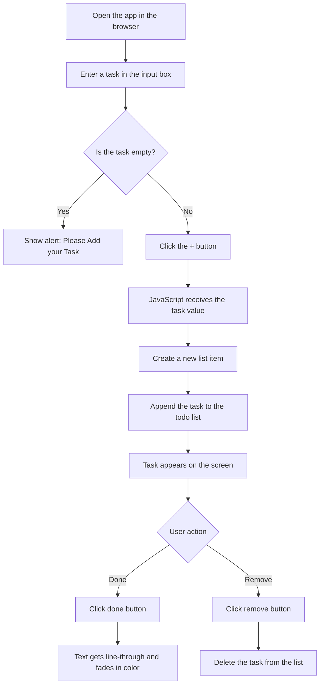

# ✅ TO-DO List

A simple and stylish task management web app built with HTML, CSS, and JavaScript. This project helps users add daily tasks, mark them as completed, and remove them when no longer needed.

## ✨ Features

- Add new tasks with a text input
- Mark tasks as done with a strike-through effect
- Remove tasks instantly
- Clean and lightweight browser-based interface
- Beginner-friendly front-end project using DOM manipulation

## 🧭 Workflow of the TO-DO App

## 🔄 Step-by-Step Process

1. The user opens `index.html` in a browser.
2. They type a task in the input field.
3. When the `+` button is clicked, JavaScript reads the value.
4. If the input is empty, an alert is shown: `please Add your Task`.
5. If the input has text, a new list item is created and added to the task list.
6. Each task contains two actions:
   - `done` → marks the task as completed
   - `remove` → deletes the task
7. The app updates the DOM dynamically without reloading the page.

## 🏗️ Project Structure

- `index.html` — main structure of the app
- `style.css` — main styling for the interface
- `second.css` — additional styling file
- `one.js` — core JavaScript logic for adding, completing, and removing tasks
- `second.html` — another HTML file in the project

## ▶️ How to Run

1. Clone or download this repository.
2. Open the project folder.
3. Launch `index.html` in your browser.
4. Start adding tasks to manage your daily to-do list.

## 📝 Notes

This project is a beginner-friendly example of front-end development using HTML, CSS, and JavaScript. It focuses on DOM manipulation, event listeners, and simple user interaction logic.

## 📌 License

This project is open for personal learning and use.
